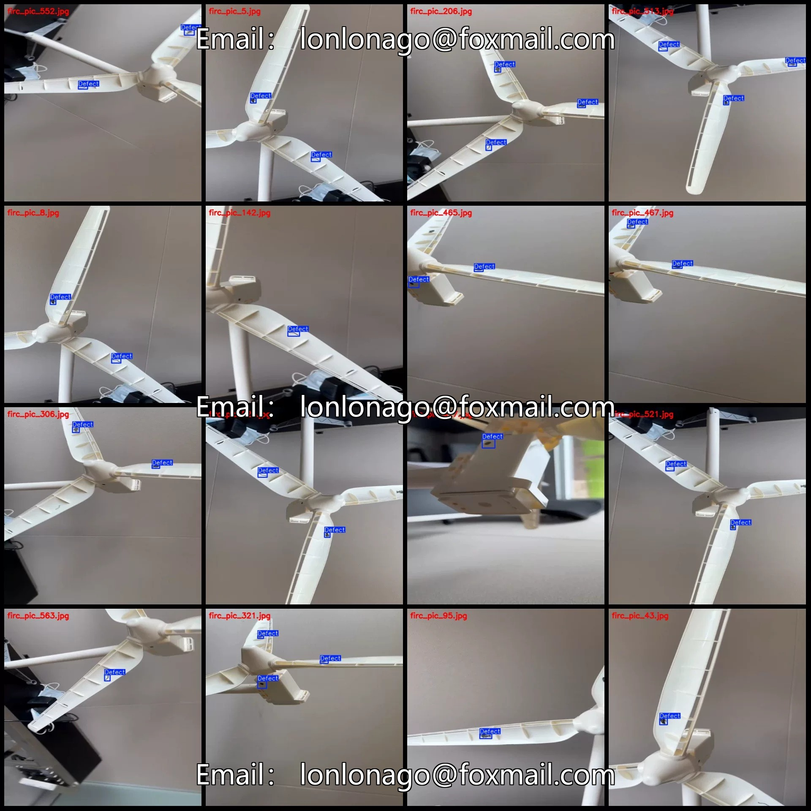
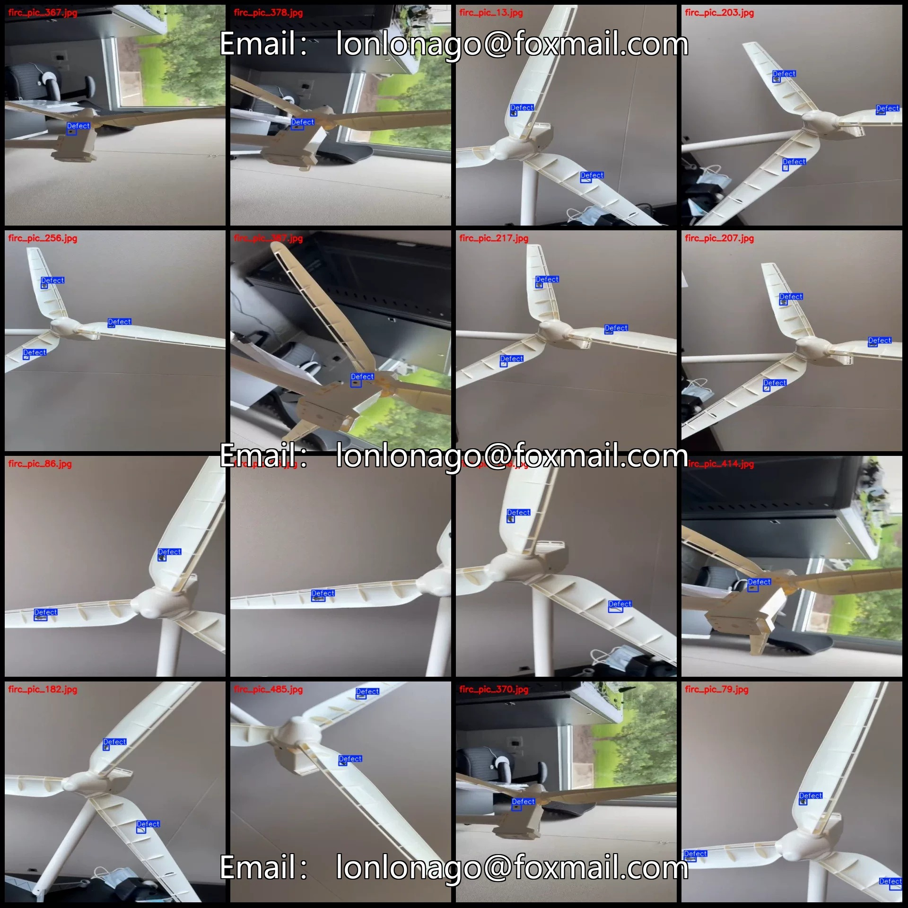
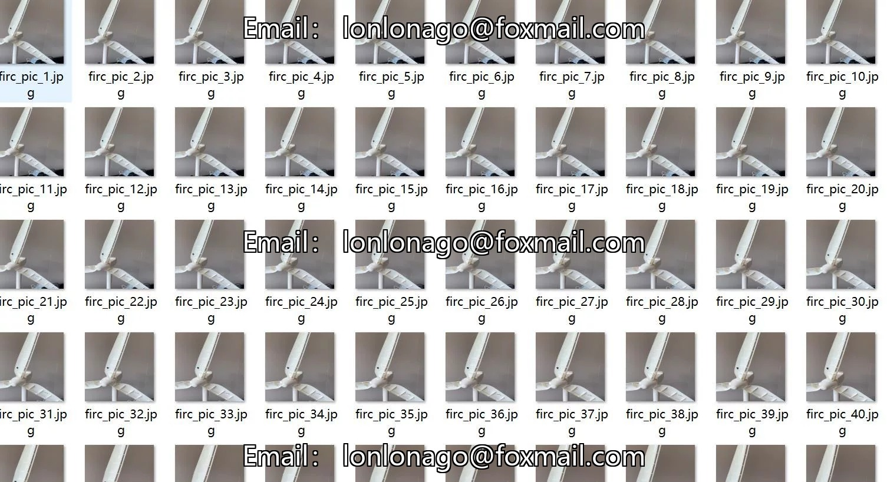
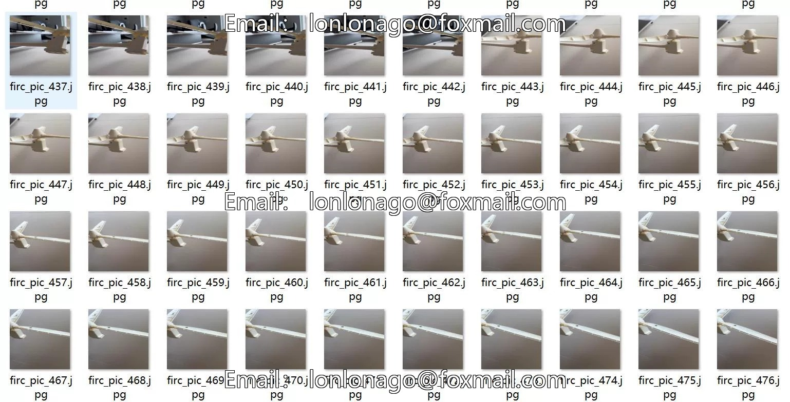
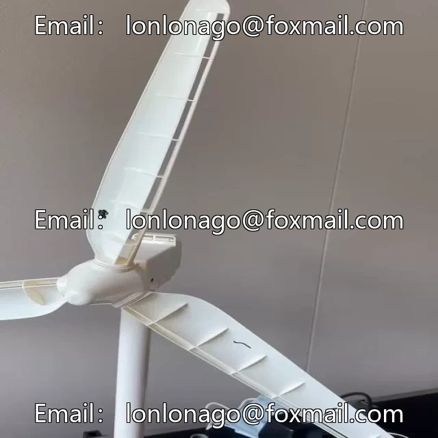
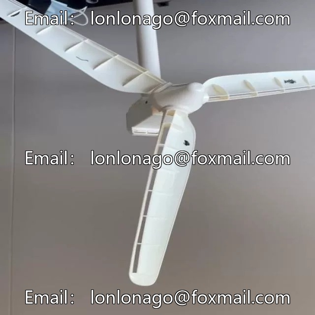

# Indoor office environment ceiling fan defect detection dataset VOC+YOLO format 586 images 1

## Body

Please note: Due to the dataset's replicability, after purchase, please confirm compliance before purchasing.
Dataset format: Pascal VOC format + YOLO format (txt file without split path, only containing jpg images and corresponding VOC format xml files and yolo format txt files)
Number of images (number of jpg files): 586
Number of annotations (number of xml files): 586
Number of annotations (number of txt files): 586
Number of annotation categories: 1
Annotation category name: ["Defect"]
Each category has a number of boxes and image counts annotated.

Defect Frames = 1060, occupied by images = 586
Total Frames: 1060
Image Resolution: 640x640
Labeling Tool: labelImg
Labeling Rules: Draw a rectangle around the category.
Important Notice: The dataset does not have split into training, validation, and test sets; you need to do this yourself.
Special Remark: This dataset does not guarantee the accuracy of the trained model or weight files.

## Images

## Payment

Here is a pay link on Stripe ( https://buy.stripe.com/3cs8yP7sY87d0vu9AB ). Please contact me lonlonago@foxmail.com after funding $89, and I will send you a complete data files , thank you!

